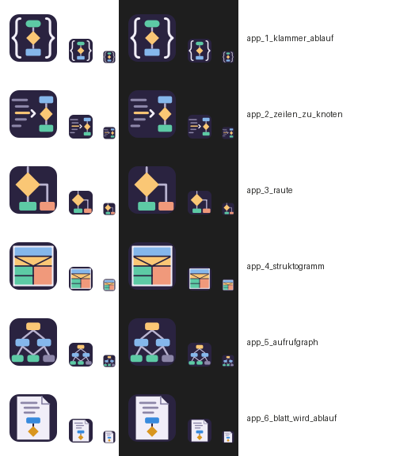

# Icons von Code2Diagram

Erster Wurf (C2D_Session10, 2026-10-21) für das **Programm-Icon** — als **SVG** (Quelle) und als
**ICO** (16–256 px, das Format für Icons unter Windows). Aufbau nach dem Muster von UART
(`../UART/assets/images/Logo/icons/`).

**Gewählt: `app_2_zeilen_zu_knoten`** (Patrik, 2026-10-21). Es ist eingebaut als Fenster-Icon
(`projects/apps/Code2Diagram/main/Code2Diagram.qrc`, `QApplication::setWindowIcon` in
`Application.cpp`) und als Icon der Exe unter Windows (`Code2Diagram.rc`, `c2d.rc`). Beide verweisen
auf die Dateien hier — wer das Icon ändert, baut hier neu und dann das Projekt. Die übrigen fünf
bleiben als Entwurf liegen.

## Alle Icons im Bild

Jedes Icon in 64, 32 und 16 px, links auf hellem, rechts auf dunklem Grund:



## Programm-Icon — sechs Kandidaten

Gemeinsam: abgerundete Kachel in Aubergine (`#2A2340`, absichtlich anders als das Navy von UART,
damit beide in der Taskleiste unterscheidbar bleiben), Knoten in den Farben Grün, Gelb, Rot, Blau.

| Bild | Datei | Was es zeigt | In 16 px (am Blatt abgelesen) |
|:---:|---|---|---|
|  | `app_1_klammer_ablauf` | `{ }` um einen kleinen Ablauf (Start, Raute, Schritt) — Code wird Diagramm | Klammern und Raute bleiben |
|  | `app_2_zeilen_zu_knoten` | links Codezeilen, Pfeil, rechts der Ablauf; die gelbe Zeile ist die Raute | Zeilen und Knoten erkennbar, Pfeil kaum |
|  | `app_3_raute` | die Raute des Flussdiagramms mit zwei Ausgängen | am deutlichsten: Raute und zwei Flächen |
|  | `app_4_struktogramm` | ein Struktogramm (Nassi-Shneiderman) mit Verzweigung | Farbfelder bleiben, Diagonalen weg |
|  | `app_5_aufrufgraph` | ein Aufrufgraph in drei Schichten, grau ein fremder Aufruf | ein Baum aus Punkten, Kanten weg |
|  | `app_6_blatt_wird_ablauf` | ein Blatt Quelltext, unten wird es zum Ablauf | Blatt erkennbar, Inhalt nicht |

Datei-Icons gibt es keine: Code2Diagram hat keinen eigenen Dateityp (die Projektdatei heißt
`code2diagram.json`). Kommt einer dazu, folgt er dem Blatt-Muster von UART.

## Neu bauen

```
python assets/images/Logo/icons/build_icons.py
```

Braucht ein normales Python mit PySide6 und Pillow (gelaufen mit Python 3.12, PySide6 6.11.1,
Pillow 12.2). Das Skript erzeugt aus seiner Tabelle `APP` je Icon die `.svg`, daraus die `.ico`
mit sieben Stufen, unter `vorschau/` ein PNG je Icon und das Blatt `uebersicht.png`.
**Die SVG sind erzeugt** — wer ein Icon ändert, ändert die Tabelle im Skript und baut neu; eine von
Hand geänderte `.svg` wird überschrieben.

## Stand

- **Gelaufen:** das Bau-Skript (6 Icons, Exit 0); das Blatt angesehen, hell und dunkel.
- **Aufgefallen:** auf dunklem Grund hebt sich die Kachel nur schwach ab (Aubergine auf `#1E1E1E`);
  der Inhalt bleibt lesbar.
- **Eingebaut:** `app_2_zeilen_zu_knoten` (siehe oben).
